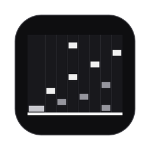
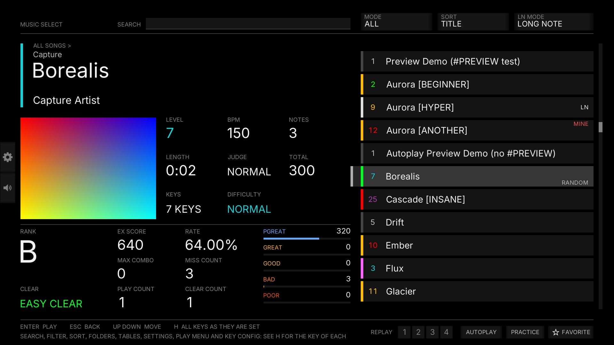
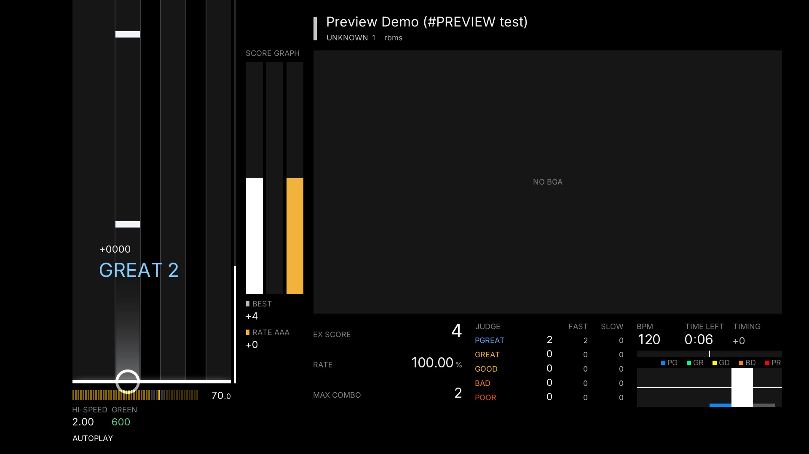

<div align="center">



# R-BMS

**A BMS rhythm-game player in Rust — reference-accurate judgment, beatoraja-compatible skins, difficulty tables, courses and online rankings.**

[Download](https://github.com/B-HS/R-BMS/releases/latest) · [Website](https://bms.hyuns.uk) · [Controls](#controls) · [Development](#development)

</div>



R-BMS reimplements the play loop of a GPL-3.0 reference implementation (beatoraja) in Rust. Judgment windows, gauges and TOTAL scaling follow the reference source, the play clock is the audio actually played, and keys are judged at the instant they arrive. It is one native binary — no JVM, no runtime to install — with its own score server and website at [bms.hyuns.uk](https://bms.hyuns.uk).

## Features

- **Play** — 5K / 7K / 9K (pop'n) / 10K / 14K, LN / CN / HCN, mines, BGA, MIRROR / RANDOM / S-RANDOM and friends, hi-speed with green number and KEEP GREEN NUMBER, lane cover, lift, HIDDEN+, SCRATCH AUTO
- **Judgment** — reference windows per mode, `#RANK` / `#DEFEXRANK`, FAST / SLOW, judge offset with AUTO ADJUST, LR2-style key and pad debounce
- **Gauges and lamps** — ASSIST EASY to HAZARD with TOTAL scaling, clear lamps with ASSIST grades for SCRATCH AUTO clears, DJ LEVEL and EX score
- **Difficulty tables** — the 発狂BMS難易度表 built in, Stella and Satellite fetched from their origin, nested folders, charts you don't own shown dimmed with a link to their download
- **Courses** — GENOSIDE 2018 dan courses (SP and DP) built in, table courses, a course gauge you choose (LR2 / beatoraja / IIDX), dans awarded on the website
- **Skins** — a monochrome default skin for every screen, beatoraja `.luaskin` and JSON skins unmodified, a live SKIN menu with colours, opacities and offsets, export of an adjusted pack
- **Online** — sign in, every run you play by hand kept and sent, rankings, rivals, ghosts, replays, settings sync, folders made on the site, AI reports
- **Discord** — shows R-BMS, the chart and the course you are on in your Discord status (can be turned off)
- **Replays and practice** — every run replayable with its seed and options, analysis with seek and per-note timing, a practice panel for slices



## Install

Download the latest release from [Releases](https://github.com/B-HS/R-BMS/releases/latest).

- **macOS** (Apple silicon and Intel) — open `R-BMS-macos-universal.dmg` and drag **R-BMS** into Applications. Signed and notarized.
- **Windows** — unzip `rbms-windows-x64.zip` and run `rbms-player.exe`. Not code-signed yet, so SmartScreen asks once.

On first run, press `O` on the song select, choose `+ ADD FOLDER`, pick your song folder and press `Esc` to scan. Settings, scores and replays live in `~/.config/rbms/` (`%USERPROFILE%\.config\rbms\` on Windows).

To play online, press `Tab` → NETWORK and sign in (or register) — the server address is set already. Runs kept before signing in are sent once you do. The walkthrough is at [bms.hyuns.uk/guide](https://bms.hyuns.uk/guide).

## Controls

Press `H` on the song select for every key as it is set right now. All keys are rebindable on keyboard and controller (`F5`).

| Key | Song select | Play |
| --- | --- | --- |
| ↑ ↓ / → Enter / ← Esc | Move / open or play / back | Hi-speed / — / leave (result if you hit a note) |
| START (`A`) / SELECT (`W`) held | Option panels | With the turntable or keys: lane cover, lift, hi-speed |
| `Tab` | Settings | — |
| `F8` / `F12` / `F5` | Play menu / skin menu / key config | — |
| `O` / `T` / `R` / `/` | Song folders / difficulty tables / records / search | — |
| `F6` | Fetch every difficulty table again | — |
| `9` / `0` | — | Judge offset −1 / +1 ms |

Lanes follow the reference keyboard layout: 7K `Z S X D C F V` with `LShift` / `LCtrl` for the turntable; 14K adds `M K , L . ; /` with `RShift` / `RCtrl`.

<details>
<summary>Command line</summary>

```sh
rbms-player [SONG_FOLDER | CHART] [options]
```

With no argument the player opens the remembered song folder, then `RBMS_SONGS`, otherwise an empty library. A single chart plays on autoplay unless `--interactive` is given. Options: `--interactive` `--auto` `--hispeed F` `--gauge NAME` `--lift F` `--sc-left` `--sc-auto` `--keys Z,S,X,...` `--skin file.ron` `--font file.ttf` `--table URL` `--keyconfig path.ron` `--replay file.ron` `--timing-csv file` `--server URL` `--player ID`; `--help` and `--version` print and exit. On macOS the binary is `/Applications/R-BMS.app/Contents/MacOS/rbms-player`.

</details>

## Development

```sh
cargo run --release -p rbms-player -- /path/to/songs
cargo test --workspace --no-fail-fast --locked
cargo clippy --workspace --all-targets --all-features --locked -- -D warnings
cargo run -p rbms-cli -- skin-dump assets/skins/rbms-default --strict --frames 120
```

Rust 1.95 (`rust-toolchain.toml`). The workspace splits into chart parsing, judgment, audio, rendering (wgpu), the Lua skin runtime, the score store, IR, tables, courses and downloads under `crates/`, with the player and a headless CLI under `apps/`. The score server and website live in [`web/`](web/) (Next.js, Drizzle + MySQL, deployed on Vercel):

```sh
cd web && bun install && bun run dev
bun run verify
```

Architecture, decisions and the reference parity ledger are in [docs/](docs/README.md) (Korean) — start with [docs/HANDOFF.md](docs/HANDOFF.md). Play options in detail: [docs/play-options.md](docs/play-options.md); skins: [docs/skin.md](docs/skin.md). Releases are cut by hand with the `release` workflow into a draft ([docs/ci-release.md](docs/ci-release.md)).

## License

[GPL-3.0-or-later](LICENSE). The play logic is a clean-room Rust port of a GPL-3.0 reference implementation. Third-party notices for bundled software (OpenH264, Inter and the Rust dependencies) are in [THIRD-PARTY-NOTICES.md](THIRD-PARTY-NOTICES.md).
